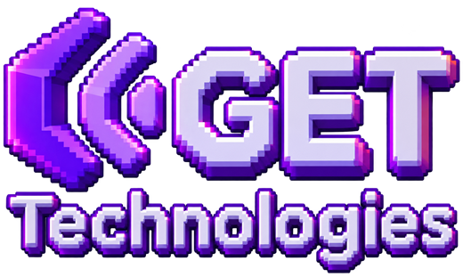

<p align="center">
  
</p>

<h1 align="center">GETechnologies Skills</h1>

<p align="center">
  Skills para agentes de código, hechas por GETechnologies para pasar de la especificación al software funcionando.
</p>

<p align="center">
  <a href="https://skills.sh/GetechnologiesMX/skills"></a>
  
  
  
  <a href="LICENSE"></a>
</p>

---

## Argos Prototype

> De especificación **Argos** a prototipo **Next.js** desplegable en **Railway**, en una sola conversación.

`argos-prototype` lee los exports de especificación que genera la plataforma Argos (contexto, funcional, técnico) y construye un **prototipo navegable**:

- **Pantallas y flujos del spec, de punta a punta.** Cada pantalla (`UI-*`) y caso de uso (`UC-*`) queda trazado a una ruta del prototipo.
- **Puro frontend.** Datos mock verosímiles, servicios simulados deterministas, cero base de datos y cero infraestructura.
- **Diseño dirigido por [impeccable](https://impeccable.style).** La skill elige la dirección visual que mejor encaja con el producto y el tipo de usuario, y pasa revisión de calidad antes de entregar.
- **Listo para Railway.** Incluye `railway.json` y te entrega los pasos exactos para publicarlo.

Solo te pregunta una cosa: **dónde están los archivos de Argos**. Todo lo demás lo decide, y lo deja documentado en `docs/DECISIONS.md` dentro del prototipo.

### Qué genera

```
<proyecto>-prototype/
├── src/app/…              # una ruta por pantalla del spec
├── src/lib/services/…     # backends simulados (latencia realista, resultados repetibles)
├── src/lib/mock/…         # datos semilla coherentes entre entidades
├── docs/BRIEF.md          # lo que entendió del spec y el guion de la demo
├── docs/TRACEABILITY.md   # ID del spec → ruta / componente
├── docs/DECISIONS.md      # supuestos y decisiones tomadas sin preguntarte
├── PRODUCT.md, DESIGN.md  # contexto y sistema visual (impeccable)
└── railway.json
```

## Instalación

**Requisitos:** Node.js 20.9 o superior y un agente compatible con Agent Skills (Claude Code, Codex, Cursor, Copilot, Gemini CLI…).

### Con skills.sh (cualquier agente)

```bash
# 1. Dependencia de diseño
npx impeccable install

# 2. Argos Prototype
npx skills add GetechnologiesMX/skills --skill argos-prototype
```

### Como plugin de Claude Code (se actualiza solo)

```
/plugin marketplace add GetechnologiesMX/skills
/plugin install getechnologies-skills@getechnologies
```

Si impeccable no está instalado, la skill lo instala en el proyecto del prototipo la primera vez que corre.

## Uso

```
/argos-prototype
```

O simplemente pídelo: *"Hazme un prototipo con las specs de Argos"*.

1. Te pregunta dónde están los exports de Argos (una carpeta o archivos `.md`).
2. Lee el spec con un indexador incluido (los exports pueden pesar cientos de KB).
3. Crea el proyecto Next.js y planea la trazabilidad.
4. Elige el diseño con impeccable.
5. Construye todas las pantallas y flujos.
6. Verifica: build, lint, detector de impeccable, revisión de diseño y recorrido en navegador.
7. Te entrega cómo correrlo en local y cómo desplegarlo en Railway.

## Formato de entrada

Los archivos Markdown que exporta Argos, con frontmatter `schema_version: mind.export.md.v1`:

| Archivo | Contenido |
|---|---|
| `<slug>-contexto-<fecha>.md` | Identidad, visión, problema, actores, notas abiertas |
| `<slug>-funcional-<fecha>.md` | Pantallas, casos de uso, requisitos, reglas |
| `<slug>-tecnico-<fecha>.md` | Datos, APIs, arquitectura, seguridad, NFRs |
| `<slug>-full-<fecha>.md` | Todo lo anterior, más el grafo de relaciones |

Con cualquier combinación funciona. El indexador también se puede usar por separado:

```bash
node skills/prototyping/argos-prototype/scripts/argos-index.mjs ./Docs --type screen
node skills/prototyping/argos-prototype/scripts/argos-index.mjs ./Docs --show UI-002
```

## Estructura del repositorio

```
skills/
└── prototyping/
    └── argos-prototype/
        ├── SKILL.md          # flujo principal (8 pasos con criterio de terminado)
        ├── references/       # formato Argos, plan, diseño, Next.js, Railway
        ├── scripts/          # argos-index.mjs (sin dependencias)
        └── templates/        # railway.json, simulate.ts
```

## Contribuir

Lee [CONTRIBUTING.md](CONTRIBUTING.md). Cada cambio a una skill lleva un changeset (`npm run changeset`) y debe pasar `npm run validate`.

## Licencia

[MIT](LICENSE) © GETechnologies
